# Today On Rails

A watchface for the Amazfit Bip 6 and a small Android app that puts your calendar on it,
through Gadgetbridge. The day runs around the screen edge as a 12-hour rail; when an event is near
or on, the **Today card** shows it large, with what comes after it — helpful for staying on track
(for example with ADHD). Your calendar never leaves the phone.

```
Google Calendar ─► Today On Rails (phone) ─► Gadgetbridge ─► watch weather ─► Today On Rails (watchface)
```

Gadgetbridge has no direct data channel to a watchface, so the agenda travels inside the **weather
location name**: the phone app sends a weather report whose "city" is the agenda text, and the
watchface reads it back.

## Screenshots

Taken on a real Amazfit Bip 6 (demo agenda).

| Nothing coming up | Next event | Today card, during an event | Last 5 minutes |
|:-:|:-:|:-:|:-:|
| 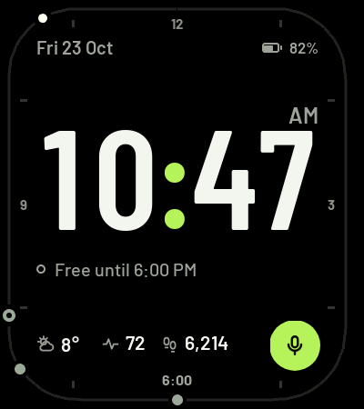 | 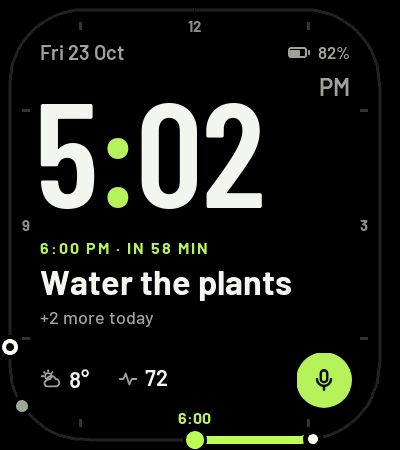 | 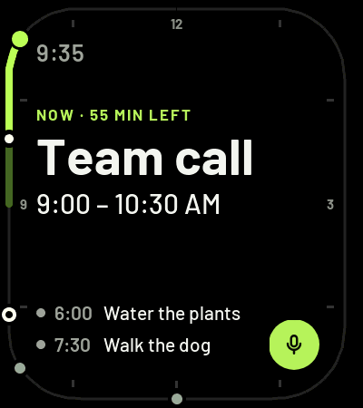 | 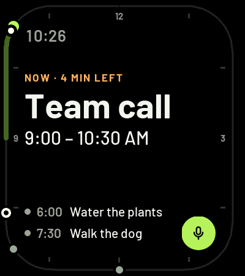 |

**Always-on**: the dim twins, with the clock in the same place as when the screen is lit:

| Clock | Next event | Today card |
|:-:|:-:|:-:|
| 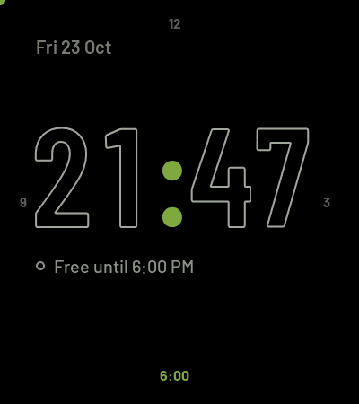 | 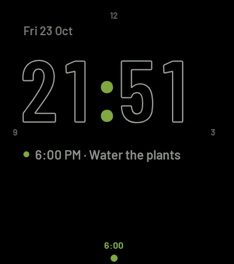 | 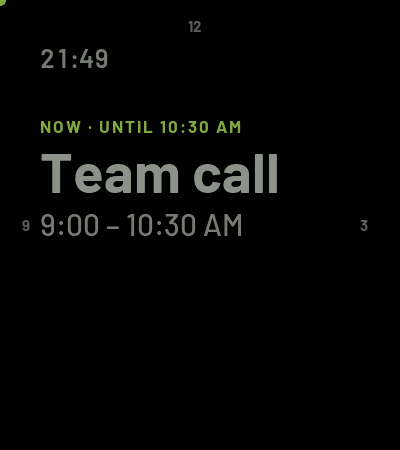 |

| Free until another day | Today card before an event | Weather off |
|:-:|:-:|:-:|
| 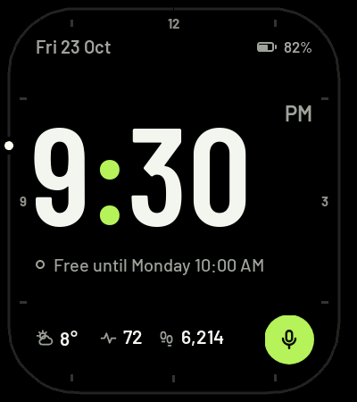 | 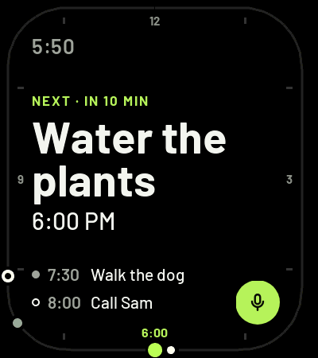 | 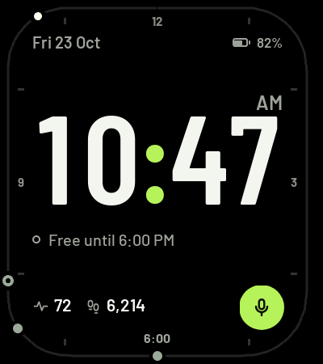 |

## Watchface

Three layouts, each with an always-on (dim) twin that keeps the clock and text in the same place:

| Layout | When (configurable in the phone app) | Shows |
|---|---|---|
| clear | nothing coming up soon | big clock, "Free until 18:00 / tomorrow 09:00 / Monday 10:00 / 12 Nov", weather, heart rate, steps |
| next | an event starts within *Show the next event from* (default 6 h), or one is on | smaller clock, "6:00 PM · IN 58 MIN" or "NOW · 25 MIN LEFT", the title, what else today, a lime arc to the event |
| Today card | *while an event is on* (default on) and/or *before an event* (default off) | the event large, its time span, the next two items |

The rail shows the next 12 hours: calendar events as rings, reminders (events without duration) as
dots, a white dot for now. While an event is on, the rail shows its whole span — the elapsed part dim,
what's left bright lime — so the time left is something you can see at a glance. In an event's last
5 minutes the "NOW · … LEFT" label turns orange, so the switch to what's next doesn't come as a
surprise. The record button opens the watch's Voice Memo app.

**Heart rate** uses the watch's own background readings (their interval is set in Gadgetbridge → Heart
rate monitoring), so the face adds no sensor use. A new reading shows immediately (`onLastChange`);
when the last one is more than 10 minutes old, the face shows your resting heart rate in grey instead,
so an old value never looks live.

**Always-on:** the always-on layouts appear only in the watch's dim always-on state (Display → Always
On Display; only while the watch is worn), never when the wrist is raised. The watch builds the face
once and, while dimmed, shows only the widgets flagged for always-on (every other widget is flagged
"lit only"). Both sets are refreshed together every minute and once more as the screen dims; the dim
clock is drawn by the system (`IMG_TIME`), and the dim texts use fixed times ("NOW · UNTIL 10:30")
instead of countdowns. Both clocks use the same fixed-width
digit slots (`ui/clockSlots.js`) and positions (`ui/clockSizes.js`), so the time doesn't move when the
watch wakes up. AM/PM sits at the top right of the clock (the widest 12-hour times wouldn't fit after
the digits).

```
watchface/watchface/index.js       entry: picks the layout, refreshes every minute and on wake
watchface/src/layouts/             one file per screen
  clear.js  next.js  focus.js                  screen on
  alwaysOnClear.js  alwaysOnNext.js  alwaysOnFocus.js
  frame.js  alwaysOnFrame.js                   the parts each group shares
watchface/src/components/          one file per visual block
  rail  alwaysOnRail  clock  alwaysOnClock  smallClock  date  battery  complications
  recordButton  freeUntil  nextEvent  alwaysOnLine  todayCard  upNext  buzzer
watchface/src/data/
  agenda.js   parse the agenda text, choose the layout, format times
  buzzes.js   which buzz is due this minute (start, 5 minutes left, get ready)
  state.js    sensors + agenda → one state object per refresh
  demos.js    fixed data for screenshots
watchface/src/ui/
  theme.js  widgets.js  text.js  railGeometry.js  clockSizes.js  clockSlots.js  metrics.js (generated)
```

## Phone app

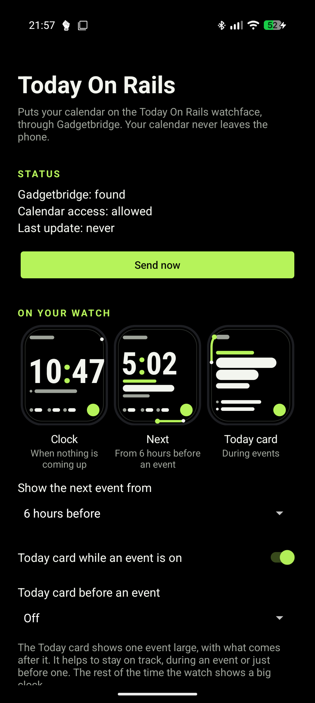

- Reads the calendars you pick (default: all visible Google calendars) for the next 7 days, including
  events that are on right now; skips all-day, cancelled and declined events.
- Settings: when to show the next event, the Today card during/before events, nudges, calendars, weather.
  A small drawing of each watchface layout shows what each setting turns on, with a line that says
  when it appears (following the settings).
- Weather from Open-Meteo is the only internet use (no account or key; only the coordinates are sent).
  Turn it off, or revoke the Network permission (GrapheneOS), and the watchface hides the weather.
- Battery: calendar changes trigger an update without polling or network (content trigger), the weather
  and look-ahead refresh once an hour in a batched background job, identical data isn't resent, and a
  time-zone or clock change sends a fresh agenda. The watch takes new data on its own weather fetch
  (about every 30 min), so updating more often wouldn't show sooner.
- **Nudges** (each can be turned off): the watch buzzes when an event starts and 5 minutes before it
  ends (both on by default); "get ready" for events with a place shows the Today card earlier (default
  1 hour, off by default) with an optional buzz. The settings travel with the agenda and **the watch
  buzzes by itself** on the minute tick it runs anyway — no notifications, no alarms on the phone. It
  can only buzz while its screen is lit or dimmed (always-on, while worn); with the screen fully off the
  face is paused, so a moment can be missed (a buzz still comes up to a minute late).
- Sends right away on first start, then keeps itself up to date in the background.
- Turn off Breezy Weather's Gadgetbridge option: only one app can send weather to Gadgetbridge.
- No libraries; three permissions: calendar (read), internet (weather), run at startup (keep the hourly job).

<br clear="right">

```
android/app/src/main/java/app/todayonrails/
  MainActivity.kt                 wires the screen's sections together, runs "Send now"
  ui/StatusSection.kt             Gadgetbridge found, calendar access, last update, buttons
  ui/WatchSection.kt              when to show which watchface layout, with a drawing of each
  ui/FacePreview.kt               the simplified drawing of a watchface layout
  ui/CalendarsSection.kt          which calendars
  ui/NudgesSection.kt             buzzes and "get ready"
  ui/WeatherSection.kt            weather on/off, city, coordinates
  settings/Settings.kt            settings and sync state
  calendar/CalendarReader.kt      calendars and events from the calendar provider
  agenda/AgendaText.kt            events + settings → agenda text
  weather/OpenMeteo.kt            forecast, WMO → OpenWeatherMap codes
  gadgetbridge/Gadgetbridge.kt    finds Gadgetbridge, sends the weather report
  sync/Sync.kt                    one update: calendar → weather → send
  sync/Scheduler.kt, SyncJob.kt, ClockChangedReceiver.kt   when to update
```

## Installing

1. **Watch:** copy `watchface/dist/*.zab` to the phone and open it with Gadgetbridge (or `tools/install.sh`).
2. **Phone:** install `android/app/build/outputs/apk/release/app-release.apk`, open it, allow calendar access.
3. In Gadgetbridge, make sure no other app sends weather (e.g. turn off Breezy Weather's Gadgetbridge option).
4. Optional: watch settings → Display → Always On Display, with "Style follows Watchface".

## Agenda text format

```
Brussels · 31/10 · cfg next=360 focus=15 during=1 · C09:00-10:30 Team call · R18:00 Water the plants · 1/11 · C14:00-15:00 Dentist
```

- Parts are separated by ` · `. The first is the city (the watch's weather app shows the whole text).
- `D/M` sets the day for the items after it; the one right after the city is required.
- `cfg next=<min> focus=<min> during=<0|1> ready=<min> buzz=<start+end+ready|none>`: the settings
  (missing → 360 / 0 / 1 / 0 / none); `ready` is the "get ready" Today card for events with a place,
  `buzz` the moments the watch vibrates.
- Items: `R` reminder (a moment) or `C` calendar event with an optional end time (`C@` = it has a place), 24-hour times, then the
  title (never containing ` · `). A time earlier than the previous one is on the next day; an end
  earlier than its start is after midnight.
- `no weather`: the phone sent no real weather; the face hides the temperature.
- The phone keeps the text under 400 characters (200 verified on the watch; the limit is about 1 KB).

## Build and test

Open the folder in the dev container (`.devcontainer/`), or on Debian/Ubuntu run `tools/setup.sh` once:
it installs Chromium, JDK 21, adb, the Android SDK (platform 37) and the Zepp build tool (`npm install`,
which also applies a fix for zeus 1.9.3 on Node 26).

```bash
git submodule update --init      # Gadgetbridge (only needed for work on Gadgetbridge itself)

# Tests (details: "Testing" below)
npm test                         # watchface + parity, watch half
npm run test:all                 # everything, both sides, plus Android lint

# Watchface
npm run assets                   # images (needs chromium) — build.sh does this when missing
tools/build.sh [demo]            # → watchface/dist/*.zab; demo names in watchface/src/data/demos.js
tools/install.sh watchface/dist/*.zab
npm run metrics                  # only after changing fonts

# Phone app
cd android
./gradlew testDebugUnitTest lintRelease assembleRelease
adb install -r app/build/outputs/apk/release/app-release.apk
```

Release signing reads `android/keystore.properties` (`storeFile`, `storePassword`, `keyAlias`,
`keyPassword`); the key and that file are not in version control. **Back up `android/release.jks` and
`android/keystore.properties`**: updates must be signed with the same key.

`tools/device/` drives Gadgetbridge over wireless adb for testing: `watchshot.sh` (watch screenshot →
PNG), `wake.sh` (Find device → back to the face), `sendweather.sh "<text>"` (fake weather broadcast).
`tools/compare.sh` and `tools/sheet.sh` put screenshots side by side.

## Testing

The phone app and the watchface share nothing but the agenda text, so the tests are built around
**parity**: [`tests/parity/cases.json`](tests/parity/cases.json) lists example days — calendar
events and settings, the exact text the phone must write for them, and what the watch must read
from that text. Both sides run every case:

```
events + settings ──AgendaText.kt──► text ──agenda.js──► what the watch sees
       └── AgendaParityTest.kt ──────┘  └── parity.test.mjs ──┘
```

Change the format on one side only and a parity test fails. Around that:

- `tests/watch/` — the watchface's logic: parser edge cases, which layout shows when, "Free until …",
  buzz timing, and the clock's digit boxes (a digit wider than its box slides sideways on the watch);
- `android/app/src/test/` — the phone's text builder: title cleaning, the size cap, buzz settings;
- the look and the buzzes are checked on the real watch with demo builds and screenshots.

`npm run test:all` (`tools/test-all.sh`) runs all of it plus Android lint. What each file covers:
[`tests/README.md`](tests/README.md).

## Repository layout

```
watchface/      Zepp OS watchface (zeus project)
android/        Android companion app (Gradle, no libraries)
tests/         parity cases shared by both sides, watchface tests (README inside)
tools/          build, asset generation, test-all.sh; tools/device/ drives the phone + watch over adb
fonts/          Barlow, Barlow Condensed (OFL)
design/         the original design boards (renders, markup specs, source HTML)
screenshots/    real watch screenshots of every layout, and the app
gadgetbridge/   Gadgetbridge (git submodule, Codeberg) — for the planned voice-assistant work
CLAUDE.md       working notes for Claude Code: conventions, device facts, how to test
HANDOFF.md      current state and how to continue
```

## Watch quirks found on the device

- `px` must be imported from `@zos/utils`; the weather call is `getForecast()` (the typings' `getForecastWeather` doesn't exist).
- Canvas `drawLine` ignores its own color/width: call `setPaint` first.
- The screen corners have an 86 px radius; the rail is concentric with them.
- Watchfaces are paused while the screen is off; they refresh in `WIDGET_DELEGATE.resume_call`.
- There's no current temperature in the weather API: the face uses the system `WEATHER_CURRENT` data widget.
- After the first one, the watch acknowledges new weather locations with status 2 and doesn't apply them;
  the city name only updates on the watch's own weather fetch.
- Always-on: the face is built once; unflagged widgets show in both states (flag them `ONLY_NORMAL`);
  `IMG_TIME` puts every digit in a fixed-width slot; a canvas flagged for always-on has no drawing methods
  ("not a function"), so the always-on rail is made of plain widgets; a CIRCLE can't be moved after it's
  created (use a round FILL_RECT). More in CLAUDE.md.

Fonts: Barlow and Barlow Condensed (SIL Open Font License, `fonts/OFL.txt`).
Designs: `design/` (renders of the original boards; the voice boards are kept for later).
